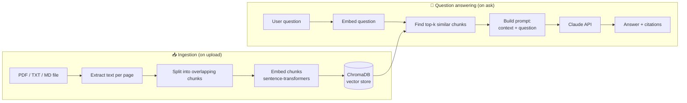

# 📄 RAG Document Q&A Assistant

Upload your PDFs or text files, ask questions in plain English, and get answers **grounded in your own documents**, with citations showing exactly which file and page each answer came from.

Built with **Python, FastAPI, ChromaDB, sentence-transformers, and the Claude API**, with a lightweight vanilla JavaScript frontend.

> 📸 **Screenshot:** add a screenshot of the app here (e.g. `docs/screenshot.png`), then replace this line with:
> ``

---

## ✨ Features

- **Upload PDF, TXT, and Markdown files** through a simple web UI
- **Semantic search:** finds relevant passages by *meaning*, not just keyword matching
- **Grounded answers with citations:** every answer references `[filename, p.X]`
- **Honest refusals:** if the answer isn't in your documents, the assistant says so instead of guessing
- **Source preview:** see the exact passages and similarity scores behind each answer
- **Document management:** list and delete uploaded documents
- **Re-upload safe:** uploading a file again replaces its old version (no duplicates)
- **Input validation:** file type, empty file, and 10 MB size checks, with friendly error messages
- **Automated tests** with the LLM mocked, so tests are fast and free
- **Docker support** for one-command deployment

---

## 🧠 What is RAG?

**RAG (Retrieval-Augmented Generation)** lets a language model answer questions about documents it was never trained on.

Instead of asking the model to answer from memory (which can lead to made-up facts), we:

1. **Retrieve** the most relevant passages from your documents
2. **Augment** the question by pasting those passages into the prompt
3. **Generate** an answer that is restricted to that provided context

This keeps answers accurate, up to date, and traceable to a source.

---

## 🏗️ How It Works



### Step by step

| Step | What happens | File |
|---|---|---|
| 1. Extract | Text is pulled from each page of the PDF (or read from a text file) | `app/ingest.py` |
| 2. Chunk | Text is split into ~800-character pieces with 150 characters of overlap so ideas aren't cut in half | `app/ingest.py` |
| 3. Embed | Each chunk becomes a vector using the `all-MiniLM-L6-v2` model (runs locally, free) | `app/vectorstore.py` |
| 4. Store | Vectors and metadata (file, page) are saved in ChromaDB | `app/vectorstore.py` |
| 5. Retrieve | The question is embedded and the 4 most similar chunks are found using cosine similarity | `app/vectorstore.py` |
| 6. Generate | The chunks and question are sent to Claude with strict instructions to answer only from the context | `app/llm.py` |
| 7. Respond | The API returns the answer plus the source passages | `app/main.py` |

---

## 🛠️ Tech Stack

| Layer | Technology | Why |
|---|---|---|
| Backend | **FastAPI** | Fast, modern, automatic API docs at `/docs` |
| PDF parsing | **pypdf** | Pure-Python, page-level text extraction |
| Embeddings | **sentence-transformers** (`all-MiniLM-L6-v2`) | Free, runs locally, no API cost |
| Vector database | **ChromaDB** | Simple, persistent, great for small to medium projects |
| LLM | **Claude (Anthropic API)** | High-quality, instruction-following answers |
| Frontend | **HTML + CSS + vanilla JS** | No build step, easy to understand |
| Testing | **pytest** + FastAPI `TestClient` | Fast automated tests |
| Containerization | **Docker** | Reproducible deployment |

---

## 📁 Project Structure

```
rag-doc-qa/
├── app/
│   ├── __init__.py
│   ├── config.py        # Settings: chunk size, models, paths, API key
│   ├── ingest.py        # File → text → chunks
│   ├── vectorstore.py   # Embeddings, ChromaDB storage, search
│   ├── llm.py           # Prompt building + Claude API call
│   └── main.py          # FastAPI app and all API endpoints
├── static/
│   └── index.html       # Frontend (upload, doc list, chat UI)
├── tests/
│   ├── conftest.py      # Uses temp folders so tests never touch real data
│   ├── test_ingest.py   # Chunking and file-reading tests
│   ├── test_vectorstore.py  # Embedding, search, delete tests
│   ├── test_api.py      # Upload, documents, validation, homepage tests
│   └── test_ask.py      # /ask endpoint tests (LLM mocked)
├── Dockerfile
├── .dockerignore
├── .gitignore
├── requirements.txt
└── README.md
```

---

## 🚀 Getting Started

### Prerequisites

- Python **3.10+**
- An **Anthropic API key** (get one at [console.anthropic.com](https://console.anthropic.com))
- Git

### 1. Clone the repository

```bash
git clone https://github.com/YOUR_USERNAME/rag-doc-qa.git
cd rag-doc-qa
```

### 2. Create and activate a virtual environment

```bash
python -m venv venv

# Mac / Linux
source venv/bin/activate

# Windows
venv\Scripts\activate
```

### 3. Install dependencies

```bash
pip install -r requirements.txt
```

> The first run downloads the embedding model (~90 MB). This happens once.

### 4. Add your API key

Create a file named `.env` in the project root:

```
ANTHROPIC_API_KEY=your_api_key_here
```

> 🔒 `.env` is listed in `.gitignore`, so your key is never uploaded to GitHub.

### 5. Start the server

```bash
uvicorn app.main:app --reload
```

### 6. Open the app

- **Web app:** http://127.0.0.1:8000
- **Interactive API docs:** http://127.0.0.1:8000/docs

---

## 🐳 Run with Docker

```bash
docker build -t rag-doc-qa .
docker run -p 8000:8000 -e ANTHROPIC_API_KEY=your_api_key_here rag-doc-qa
```

Then open http://localhost:8000.

---

## 🔌 API Reference

| Method | Endpoint | Description |
|---|---|---|
| `GET` | `/health` | Health check, returns `{"status": "ok"}` |
| `POST` | `/upload` | Upload a PDF/TXT/MD file (max 10 MB); extracts, chunks, embeds, and stores it |
| `GET` | `/documents` | List all indexed documents |
| `DELETE` | `/documents/{filename}` | Remove a document and its vectors |
| `GET` | `/search?q=...&k=4` | Raw semantic search (returns matching chunks, no LLM) |
| `POST` | `/ask` | Ask a question; returns an answer plus sources |

### Example: ask a question

**Request**

```bash
curl -X POST http://127.0.0.1:8000/ask \
  -H "Content-Type: application/json" \
  -d '{"question": "What is the refund policy?"}'
```

**Response**

```json
{
  "question": "What is the refund policy?",
  "answer": "Refunds are available within 30 days of purchase [policy.pdf, p.2].",
  "sources": [
    {
      "source": "policy.pdf",
      "page": 2,
      "score": 0.71,
      "snippet": "Customers may request a full refund within 30 days of purchase..."
    }
  ]
}
```

### Error responses

| Status | Meaning |
|---|---|
| `400` | Unsupported file type |
| `404` | Document not found (on delete) |
| `413` | File larger than 10 MB |
| `422` | Empty file, unreadable file, no extractable text, or question too short/long |
| `502` | The AI service call failed |

---

## ⚙️ Configuration

All settings live in `app/config.py`:

| Setting | Default | What it controls |
|---|---|---|
| `CHUNK_SIZE` | `800` | Characters per chunk |
| `CHUNK_OVERLAP` | `150` | Characters shared between neighboring chunks |
| `EMBED_MODEL` | `all-MiniLM-L6-v2` | Embedding model |
| `CLAUDE_MODEL` | `claude-sonnet-5-5` | Model used to generate answers |
| `TOP_K` | `4` | Number of chunks retrieved per question |
| `MIN_SCORE` | `0.15` | Chunks less similar than this are ignored |

**Tuning tips**

- Answers miss details → increase `TOP_K` or `CHUNK_SIZE`
- Answers include irrelevant info → decrease `TOP_K` or raise `MIN_SCORE`
- Ideas split across chunks → increase `CHUNK_OVERLAP`

---

## 🧪 Running Tests

```bash
python -m pytest -v
```

The test suite covers chunking logic, embedding and search, upload validation, document management, the `/ask` endpoint, and the homepage. Claude is **mocked** in tests, so no API calls are made and no credits are used. Tests run against temporary folders, so your real uploads and database are never touched.

---

## 🧩 Design Decisions

- **Local embeddings:** using sentence-transformers keeps indexing free and private; only the final question and retrieved context are sent to the LLM.
- **Strict system prompt:** the model is told to answer *only* from the provided excerpts and to admit when it can't find the answer. This reduces hallucination.
- **Overlapping chunks:** overlap preserves context at chunk boundaries so sentences aren't cut off mid-thought.
- **Similarity threshold:** weakly related chunks are dropped, so unrelated questions get an honest "not found" instead of a forced answer.
- **Replace on re-upload:** chunk IDs are derived from `filename::page::chunk_index`, and old chunks are deleted before inserting new ones, so duplicates never build up.
- **Lazy model and client loading:** the embedding model and API client load on first use, so the app starts fast and tests don't need an API key.
- **No frontend build step:** a single `index.html` keeps the project easy to read, run, and deploy.

---

## ⚠️ Known Limitations

- **Scanned PDFs are not supported** (image-only pages need OCR)
- **No conversation memory:** each question is answered independently
- **Single-user:** no authentication or per-user document separation
- **Answer quality depends on retrieval:** if the right chunk isn't retrieved, the answer will be incomplete
- **Tables and complex layouts** in PDFs may extract imperfectly
- **Large embedding model dependency:** needs enough RAM on small hosting tiers

---

## 🗺️ Roadmap

- [ ] Streaming answers (token by token)
- [ ] OCR support for scanned PDFs
- [ ] Conversation memory / follow-up questions
- [ ] User accounts and per-user document collections
- [ ] Re-ranking retrieved chunks for better accuracy
- [ ] Support for DOCX and web page URLs
- [ ] Highlight the cited passage inside the source document
- [ ] Evaluation script to measure answer quality

---

## 📚 What I Learned

- How embeddings and vector similarity search work
- Designing a full RAG pipeline: ingestion, retrieval, and generation
- Building and validating a REST API with FastAPI
- Writing prompts that reduce hallucination
- Testing code that depends on external APIs by using mocks
- Containerizing a Python app with Docker

---

## 🤝 Contributing

Suggestions and improvements are welcome:

1. Fork the repo
2. Create a branch: `git checkout -b feature/my-feature`
3. Commit your changes: `git commit -m "add my feature"`
4. Push: `git push origin feature/my-feature`
5. Open a pull request

---

## 📄 License

This project is licensed under the MIT License. Add a `LICENSE` file to your repo (GitHub can generate one for you via **Add file → Create new file → name it `LICENSE` → Choose a license template**).

---

## 👤 Author

**Abhinav**

- GitHub: [@YOUR_USERNAME](https://github.com/YOUR_USERNAME)
- LinkedIn: [your-linkedin-url](https://linkedin.com/in/your-profile)

---

⭐ If you found this project useful, consider giving it a star!
